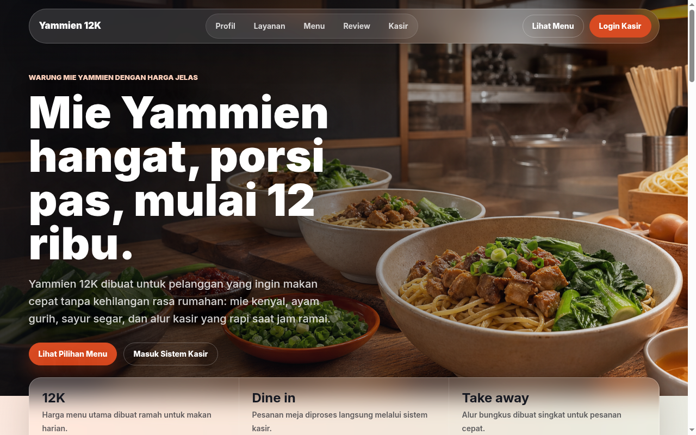

# Kasir Warung Yamien

Kasir Warung Yamien adalah aplikasi kasir berbasis web untuk warung makan. Aplikasi ini dibuat sebagai tugas besar mata kuliah Informatika untuk Masyarakat. Terdapat dua peran pengguna, yaitu admin dan kasir. Admin mengelola data master dan laporan. Kasir melayani pesanan melalui keranjang belanja dan pembayaran tunai atau Midtrans.

## Fitur

- Login dan registrasi pengguna dengan peran admin dan kasir
- Dashboard dan halaman kasir
- Kelola kategori dan produk oleh admin
- Kelola data meja dan status meja
- Kelola akun pengguna oleh admin
- Keranjang belanja untuk menyusun pesanan
- Pembuatan pesanan dan riwayat pesanan
- Pembayaran online melalui Midtrans dengan endpoint callback
- Struk pesanan yang dapat dicetak
- Ekspor laporan pesanan ke PDF dan CSV
- Log aktivitas pengguna dengan ekspor PDF dan CSV

## Teknologi

- PHP 8.2
- Laravel 12
- MySQL
- Blade, Tailwind CSS, dan Alpine.js
- Vite
- Dompdf untuk berkas PDF
- Midtrans PHP SDK untuk pembayaran

## Cara Instalasi

Prasyarat:

- PHP 8.2 atau lebih baru
- Composer
- MySQL
- Node.js dan npm

Langkah instalasi:

1. Clone repositori ini.
2. Masuk ke folder proyek lalu jalankan `composer install`.
3. Jalankan `npm install`.
4. Salin file `.env.example` menjadi `.env`, lalu sesuaikan isinya. Bagian penting adalah `APP_KEY`, koneksi database `DB_CONNECTION`, `DB_HOST`, `DB_PORT`, `DB_DATABASE`, `DB_USERNAME`, `DB_PASSWORD`, dan kunci Midtrans `MIDTRANS_CLIENTKEY`, `MIDTRANS_SERVERKEY`, `MIDTRANS_IS_PRODUCTION`.
5. Jalankan `php artisan key:generate`.
6. Jalankan `php artisan migrate --seed`.

## Cara Menjalankan

Jalankan dua perintah berikut di terminal terpisah:

```bash
php artisan serve
npm run dev
```

Aplikasi dapat dibuka di `http://127.0.0.1:8000`. Pengguna yang belum login diarahkan ke halaman landing dan login.

Callback pembayaran Midtrans diarahkan ke endpoint `/midtrans/callback`.

## Tangkapan Layar



## Lisensi

Proyek ini memakai lisensi MIT. Lihat berkas [LICENSE](LICENSE).
